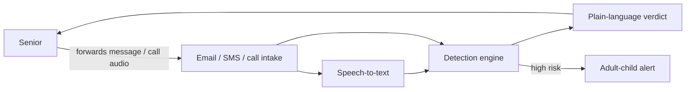

# Architecture — scam-shield

## 1. Scope
Explainable scam detection for messages and call transcripts aimed at older adults, plus a
family safe-word protocol.
**MVP:** weighted rule engine (tactic signals), look-alike domain detection, link analysis, verdict and advice, PBKDF2 safe word.
**Product:** forward-to-check email/SMS, live call screening, family alert dashboard, ML second opinion.

## 2. System context

## 3. Detection model
Signals are independent detectors, each with a weight and evidence:
- tactic lexicons: urgency, secrecy, gift cards, untraceable payment, family emergency, authority,
  credential request, prize, refund lure
- sender domain look-alike: homoglyph normalisation, Levenshtein = 1 to a brand (length ≥ 5), brand
  embedded in another domain, punycode
- links: raw IP, URL shortener, shown-host ≠ actual-host

`score = Σ strongest weight per signal (+10 if ≥ 3 tactics), capped at 100` → `safe < 20 ≤ suspicious < 50 ≤ likely scam`.

## 4. Design decisions
- **Explainability over accuracy-at-all-costs.** The user has to *believe* the verdict, so every
  point traces to quoted evidence and a plain-English action.
- **Combination bonus.** Real scams stack tactics (urgency + secrecy + gift cards), and single
  signals are often benign.
- **Safe words are hashed with PBKDF2-SHA256** (200k iterations) and a salt, then normalised for
  case and whitespace. The plain word is never stored.
- An ML classifier is a *second opinion* layer later, never the sole decider.

## 5. Production architecture
Intake (SES / Twilio), stateless engine service, Postgres (users, family links, events), and push
alerts. Call screening uses streaming STT with rolling-window scoring and a prompt to "ask for the safe word".

## 6. Risks
False positives erode trust, so thresholds are tuned on a labelled corpus. Lexicons need i18n.
The adversary adapts, so the lexicon must update without a release (remote config).

## 7. Limitations (sell-ready audit, 2026-10-28)
- No feature gating by plan: every API key unlocks the same software. Family's
  6-person cap and Care Partner's bulk checks are not implemented and were
  removed from sales copy; Care Partner differs by human priority support.
- Scores are rule-based, not a guarantee: a new scam phrasing the lexicon does
  not cover will score low, and a benign message stacking several signals can
  score high. Verdicts are advice, not a fraud determination.
- The hosted API previously hung on a `check` with no text: the CLI falls back
  to stdin, and the web subprocess inherited the server's stdin. Fixed in this
  run by giving the subprocess DEVNULL stdin, and `check ""` now means an empty
  message instead of "read stdin".
- Docker build and a live Render/Fly deployment were not verified in the audit
  environment (no Docker binary there); Dockerfile, render.yaml, and fly.toml are
  the same template shape as vibe-lube, but a deployment claim remains
  "not verified" until one is made.
- Stripe prices were not verified against a live Stripe account in this run;
  checkout and revocation are covered in tests with mocked Stripe calls, and the
  README example now uses personal/family/care-partner plan keys to match the
  plan names.
